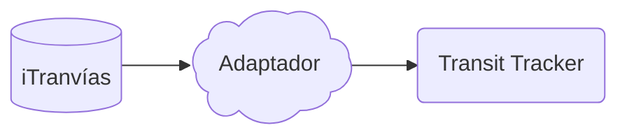

# API Server

El panel no habla con iTranvías directamente. Habla con un servicio pequeño, incluido en este repositorio en `api/`, que traduce la API `queryitr` de iTranvías al formato que el dispositivo ya entiende: las mismas rutas REST del configurador y el mismo WebSocket `schedule:subscribe`.

La fuente de datos es únicamente la red de la Compañía de Tranvías de La Coruña:

`https://itranvias.com/queryitr_v3.php`

La descripción de esa API está en [itranvias_api](https://pedrorey.es/itranvias_api/itranvias_api.html). No hay feeds GTFS, OneBusAway, HAFAS ni ninguna otra ciudad.



iTranvías publica los buses que están en servicio, con los minutos que faltan para llegar a la parada. El adaptador convierte eso en viajes con `arrivalTime` y `departureTime` en tiempo Unix, el nombre comercial de la línea y un destino. El destino sale del recorrido: la primera ruta de la línea va hacia `nombre_dest`, la segunda hacia `nombre_orig` y la última parada reportada por el bus elige el sentido.

Cuando una línea no tiene buses activos, no hay hora de paso planificada que mostrar. El panel enseña que no hay próximas llegadas.

## Arranque

```bash
cd api
python3 -m venv .venv
. .venv/bin/activate
pip install -r requirements.txt
python -m itranvias_adapter
```

También se puede levantar con `docker compose up --build` dentro de `api/`. Escucha en el puerto 8080.

En el configurador, pestaña **Advanced**, la URL del API es `http://<servidor>:8080` (o `https://` si lo publicas detrás de TLS). El configurador la reescribe a `ws://` o `wss://` al grabarla en el dispositivo. El único feed es `coruna`. Los identificadores que guarda el panel son del estilo `coruna:100` para la línea 1 y `coruna:1` para la parada Puerta Real.

El reloj del firmware usa `Europe/Madrid` y el texto por defecto de una llegada inmediata es «Ahora».
